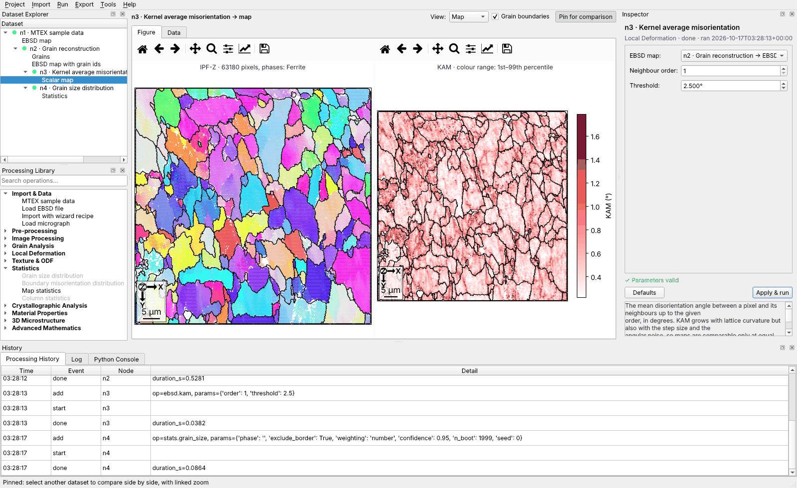
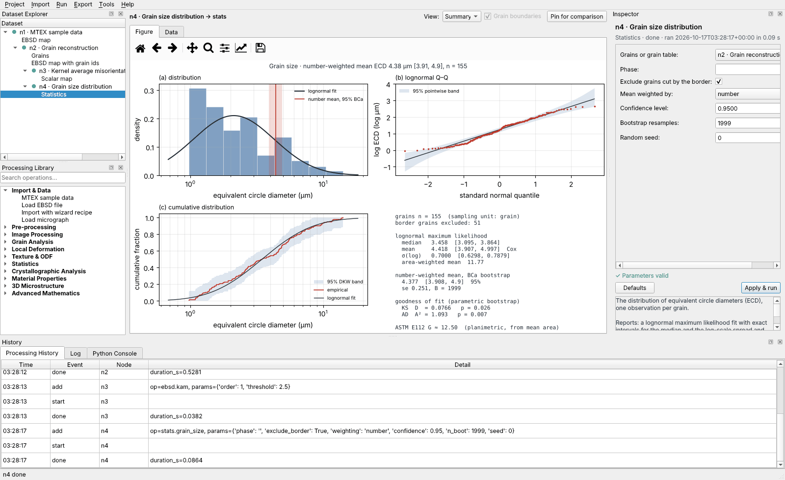
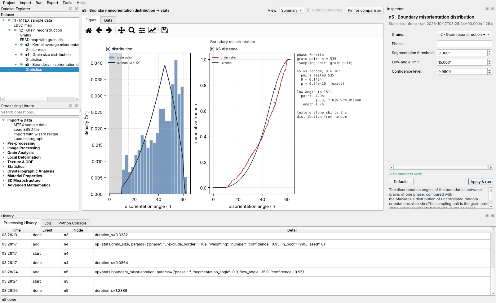

# MTEX Workbench

A desktop application around [MTEX for Python](https://mtex-toolbox.github.io) (`pip install mtex`) for
EBSD maps, grains, textures and plain micrographs. You import a dataset, pick an operation that applies
to it, set its parameters, look at the result and export a report, without writing code for routine work.
The full MTEX library stays one click away in the Python console and the function browser.



## Install and run

```bash
pip install -e ".[gui,test]"     # Python ≥ 3.12; pulls mtex, numpy, scipy, matplotlib, h5py, numba, PySide6
mtex-workbench                   # the desktop application
python -m mtex_workbench gui my_project.mtexwb
```

The first computation starts a worker process and compiles MTEX's numba kernels, which takes a few
seconds once per session. The MTEX sample data (`Import ▸ MTEX sample data`) is downloaded on first use.

## Using it

The window has four regions, all dockable:

| Region | What it does |
|---|---|
| **Dataset Explorer** (left) | The processing graph as a tree: each step under its primary input, its outputs under it, with status dots (grey stale, blue running, green done, red failed). Right-click to run, force a recompute, export the script up to this step, or remove the step and its dependants. |
| **Processing Library** (left) | Operations by category. Only the operations whose primary input accepts the selected dataset are enabled, and a disabled one says what it needs. Searchable. |
| **Viewer** (centre) | The figure of the selected result, with zoom and pan, a choice of views, optional grain-boundary overlay, and **Pin for comparison**: the pinned result stays on the left, with zoom and pan linked to the current one. The **Data** tab shows the numbers. |
| **Inspector** (right) | The parameters of the selected operation or step, built from its declaration and validated as you type. **Add & run** creates a new step; **Apply & run** changes an existing one. The help text under it says what the operation computes and what its result means. |
| **History / Log / Python Console** (bottom) | Every add, change, run and failure with its time. The console shares a namespace with the workbench: `out('n3', 'map')` is a result, `pipeline` the graph, and `from mtex import *` gives all of MTEX. |

Typical EBSD session: `Import ▸ EBSD file` (or `MTEX import wizard`, or `MTEX sample data ▸ ferrite`), then
*Grain reconstruction* (set the threshold and minimum size), then from its *EBSD map with grain ids* output
*Kernel average misorientation* and *GROD*, and from *Grains* the *Grain table*, *Grain size distribution* and
*Boundary misorientation distribution*. Changing the threshold later marks everything downstream stale.
`Run ▸ Run all stale` (Shift+F5) recomputes it.

Typical micrograph session: `Import ▸ Micrograph` with the pixel size from the scale bar, then *Gaussian
filter*, *Threshold* (Otsu), *Segment grains*, *Grain size distribution* with Miles–Lantuéjoul weighting.

**A micrograph carries intensities, not orientations.** Filtering and geometric segmentation work on it.
Orientation maps, ODFs, misorientations and GND densities need indexed EBSD data, and the library does
not offer them for an image.

## Operations

| Category | Operation | MTEX underneath |
|---|---|---|
| Import & Data | MTEX sample data · Load EBSD file · Import with wizard recipe · Load micrograph | `mtexdata`, `loadEBSD`, the import wizard's script |
| Pre-processing | Keep indexed · Select phase · Threshold a property (CI, IQ, MAD, …) · Crop rectangle · Denoise orientations (median, mean, spline, half-quadratic, infimal convolution, Kuwahara) | `ebsd[...]`, `inpolygon`, `ebsd.smooth(…Filter)` |
| Grain Analysis | Grain reconstruction · Smooth boundaries · Grain table (area, ECD, perimeter, aspect ratio, shape factor, GOS, border flag) | `calcGrains`, `smoothBoundary`, `grain2d` properties |
| Local Deformation | Kernel average misorientation · Grain reference orientation deviation | `ebsd.KAM`, `ebsd.calcGROD` |
| Texture & ODF | ODF by kernel density estimation · Texture strength (texture index, entropy, maximum) | `calcDensity`, `textureIndex`, `entropy`, `max` |
| Image Processing | Gaussian · Median · Threshold (Otsu or manual) · Segment grains | SciPy `ndimage` |
| Statistics | Grain size distribution · Boundary misorientation distribution · Map statistics · Column statistics | `calcAngleDistribution` for the Mackenzie reference |

`mtex-workbench ops` lists every operation with its inputs, outputs, parameters, defaults and ranges.

Crystallographic analysis (parent grains, variants), material properties (tensors, Schmid, Taylor), 3D
microstructures and the advanced numerics have no dedicated dialogs yet. The library shows these
categories, and their 779 MTEX functions are reachable through `Tools ▸ MTEX function browser` and the
Python console.

## The statistics

Each result states its **sampling unit**, and intervals are only computed over units that can be treated
as independent. Neighbouring EBSD pixels are strongly correlated (they share grains and the same
diffraction noise), so the workbench never reports a pixel-level confidence interval.

**Grain size** (one observation per grain, equivalent circle diameter $d$):

- Lognormal maximum likelihood, $\log d \sim N(\mu, \sigma^2)$, with exact intervals. The interval for
  $\mu$ is $\bar y \pm t_{n-1,\,1-\alpha/2}\, s/\sqrt n$, and the interval for $\sigma$ is
  $\big[\sqrt{(n-1)s^2/\chi^2_{n-1,\,1-\alpha/2}},\ \sqrt{(n-1)s^2/\chi^2_{n-1,\,\alpha/2}}\big]$. The
  median $e^{\mu}$ inherits the $\mu$ interval. The number-weighted mean $e^{\mu+\sigma^2/2}$ gets Cox's
  interval $\exp\!\big(\bar y + s^2/2 \pm z\sqrt{s^2/n + s^4/(2(n-1))}\big)$. The area-weighted mean,
  i.e. the mean diameter of the grain a random point falls in, is $E[d^3]/E[d^2] = e^{\mu + 5\sigma^2/2}$.
- Goodness of fit by Kolmogorov–Smirnov and Anderson–Darling. Because $\mu$ and $\sigma$ are estimated
  from the same data, tabulated p-values would be far too large (the Lilliefors problem). The p-values are
  therefore calibrated by the parametric bootstrap, $p = (1 + \#\{T^* \ge T\})/(B+1)$. The test suite checks
  that they are uniform under the null.
- A distribution-free BCa bootstrap interval for the number-, area- or Miles–Lantuéjoul-weighted mean.
  The bias correction is $z_0 = \Phi^{-1}(\#\{\hat\theta^* < \hat\theta\}/B)$, and the acceleration comes
  from the jackknife (closed form for weighted means).
- Grains cut by the map border are truncated and are excluded by default. That exclusion loses large
  grains preferentially. For segmented micrographs the **Miles–Lantuéjoul** weight
  $WH/((W-w-1)(H-h-1))$, with $w \times h$ the bounding box, undoes that loss. A simulation in the tests
  confirms it.
- ASTM E112 planimetric grain size number $G = 3.321928\,\log_{10} N_A - 2.954$ from the mean grain area.

The figure shows the histogram with the fitted density and the mean's interval band, a lognormal Q–Q plot
with the exact pointwise 95 % band of the order statistics ($U_{(i)} \sim \mathrm{Beta}(i, n-i+1)$), and the
empirical CDF with the Dvoretzky–Kiefer–Wolfowitz band $\pm\sqrt{\ln(2/\alpha)/2n}$.



**Boundary misorientation** (one observation per *grain pair*, the median angle over its boundary
segments; every segment between the same two grains has nearly the same misorientation). The reference is
the Mackenzie distribution of uncorrelated random orientations for the crystal symmetry. Grains
reconstructed with threshold θ cannot have boundaries below θ, so the reference is **conditioned** on
ω ≥ θ: $F_\theta(\omega) = (F(\omega) - F(\theta))/(1 - F(\theta))$. The KS test against this fully
specified CDF has an exact p-value. Without the conditioning the test would reject by construction. The
low-angle fraction gets a Wilson interval over grain pairs, and the length fraction is reported
descriptively. A small p-value means only that the population differs from random. Texture alone causes
that, and the right reference for a textured material is the uncorrelated MDF of its ODF.



**Map statistics** (KAM, GROD): pixel quantiles are descriptive only. When the map carries grain ids,
each grain contributes the mean of its pixels, and the BCa interval is over grains.

All random procedures take a seed and are reproducible.

## Reproducibility

- **Non-destructive.** An operation never changes its input. *Grain reconstruction*, for instance,
  returns a new map carrying grain ids beside the grains. Each step stores its own outputs.
- **Invalidation.** Changing a step's parameters or inputs marks it and everything downstream stale. A
  result shown is always the one its displayed parameters produce.
- **Provenance.** Every run records the start time, the duration, the operation's version, the versions
  of Python, MTEX, NumPy, SciPy, matplotlib and numba, and the SHA-256 of every input file. A fingerprint
  hashes the operation, parameters, upstream fingerprints and file contents. When a project is opened,
  input files that changed on disk are detected and their results marked stale.
- **Scripts.** `Export ▸ Python script` writes a standalone script. MTEX operations appear as the MTEX
  calls themselves (`calcGrains(...)`, `ebsd.KAM(...)`). Workbench operations run through `run_op`, which
  executes the same code the interface ran and gets the metadata its inputs carried. The tests execute the
  exported scripts and check bit-identical results.
- **Projects.** A project is a folder `name.mtexwb` holding `project.sqlite` (nodes, parameters,
  provenance, history) and `results.h5`. Arrays, tables and scalar maps are plain HDF5 datasets. MTEX
  objects are pickled with the MTEX and Python versions that wrote them. If a project is opened under a
  different MTEX version, they are recomputed from the recorded parameters instead of being unpickled.
  Saving is atomic.
- **Report.** `Export ▸ Report and results` writes `report.pdf` (a provenance title page, then one
  captioned page per result), PNG figures, CSV tables, JSON statistics, `pipeline.json`,
  `provenance.json` and `analysis.py`.

## Batch processing

A pipeline built on one specimen is a template for the others:

```bash
mtex-workbench run examples/ferrite_analysis.json -o out/ --save out/ferrite
mtex-workbench batch examples/ebsd_batch_template.json -i a.ang b.ang c.ang -o batch/
mtex-workbench run template.json -o out/ --set n2.angle=12      # change a parameter
```

`batch` swaps the file of the template's source step for each input, writes one report folder per
specimen, and writes `summary.csv`: one row per specimen with the file hash and every scalar statistic
(estimates and interval bounds), ready for comparing specimens. A failing specimen is reported and
skipped. `Tools ▸ Batch processing` does the same from the interface, in a separate process.

## Architecture

```
src/mtex_workbench/
  core/types.py       DataKind (EBSD, GRAINS, SCALAR_MAP, ODF, TABLE, IMAGE, LABELS, STATS) and DataItem
  core/params.py      typed, strictly validated parameter declarations
  core/registry.py    operations: inputs, outputs, parameters, help, script template
  core/pipeline.py    the processing graph: add, invalidate, run, fingerprint, serialise
  core/executor.py    inline, or a warm cancellable worker process
  core/storage.py     SQLite + HDF5 projects
  core/script.py      script export and run_op
  stats.py            the statistical methods (NumPy/SciPy only)
  ops/                the operations, thin typed wrappers over MTEX and stats
  viz/render.py       a figure for every data kind
  report.py           PDF report and result files
  gui/                PySide6: main window, widgets, console, function browser, batch dialog
  cli.py              gui, ops, run, batch, script
```

Adding an operation means declaring it, with no new dialog:

```python
from mtex_workbench.core import Float, operation, Output, Port, DataKind, DataItem

@operation("ebsd.my_measure", "My measure", "Local Deformation",
           inputs=(Port("ebsd", (DataKind.EBSD,), "EBSD map"),),
           outputs=(Output("map", DataKind.SCALAR_MAP, "Scalar map"),),
           params=(Float("radius", "Radius", 1.0, minimum=0, unit=" µm"),))
def my_measure(ebsd, radius):
  """What it computes and how to read it (shown in the inspector)."""
  values = ...  # MTEX calls on ebsd.value
  return DataItem(DataKind.SCALAR_MAP, {"ebsd": ebsd.value, "values": values}, {"label": "M", "unit": "°"})
```

The library lists it under its category for EBSD maps. The inspector builds its controls. The engine
validates, runs, caches, invalidates, stores and exports it.

## Tests

```bash
pytest            # 62 tests, about 30 s; the MTEX tests download the ferrite sample once
```

The tests cover:
- **Statistics.** MLE against SciPy. Monte Carlo coverage of the t, χ², Cox, BCa and Wilson intervals.
  Uniformity of the bootstrap goodness-of-fit p-values under the null, and their power.
  Miles–Lantuéjoul unbiasedness by simulation. The Mackenzie mean of 40.7° for cubic symmetry.
- **Engine.** Strict parameters, invalidation, cycle rejection, project round trips (including across
  MTEX versions), script reproduction, worker-process equality and cancellation.
- **Operations.** Every operation on the ferrite map, every figure kind, and the micrograph path on
  synthetic Voronoi microstructures with known grain counts.
- **CLI and GUI.** Run and batch from the command line, and the GUI offscreen.

## Windows

The application is pure Python and Qt, so it runs on Windows from a Python installation
(`pip install -e .[gui]`, then `mtex-workbench`). The worker process uses the `spawn` start method, which
is what Windows requires, and `__main__` calls `multiprocessing.freeze_support()` for frozen builds.
A single-file installer (PyInstaller or Briefcase) is not part of this version and has not been built or
tested yet.

## Licence

GPL-2.0, the licence of MTEX, because the workbench imports and is distributed with MTEX
(see `LICENSE`). When publishing results, cite MTEX: F. Bachmann, R. Hielscher, H. Schaeben, *Texture
analysis with MTEX – free and open source software toolbox*, Solid State Phenomena 160 (2010) 63–68.
